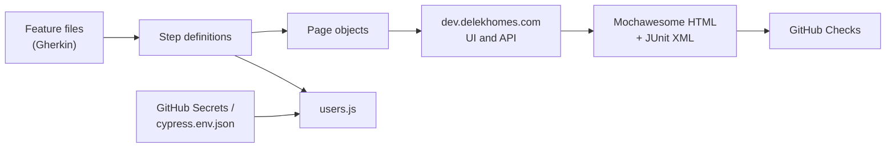

# Delek Homes — Cypress BDD Tests

> Behavior-driven Cypress suite for [Delek Homes](https://dev.delekhomes.com), a real estate listings demo app. Scenarios are written in Gherkin and cover login, registration, creating listings through the UI and the API, and listing search.


## Pipeline

| Stage | Job | What it does |
|---|---|---|
| Install | `install` | Installs dependencies and caches `node_modules` and the Cypress binary |
| Test | `test` | Runs the Cucumber scenarios in Chrome, with test accounts from GitHub Secrets |
| Report | `report` | Publishes the JUnit results as a GitHub Check through [dorny/test-reporter](https://github.com/dorny/test-reporter) |
| Notify | `notify` | Writes a table of stage results to the run page |

The workflow runs on every push and pull request to `main`. Any failing scenario fails the pipeline. The Mochawesome HTML report and failure screenshots are attached to each run as artifacts.



## What's Tested

16 scenarios in 6 feature files:

| Area | Feature | Scenarios | Needs an account |
|---|---|---|---|
| Auth | `auth/login.feature` | Sign in with an existing account, sign out | Yes |
| Auth | `auth/registration.feature` | Register a new random account, reject an existing email, required-field errors (data table) | Only the existing-email scenario |
| Listings | `listings/createListing.feature` | Publish a listing with a photo after signing in through the UI or the API (Scenario Outline) | Yes |
| Listings | `listings/listingApi.feature` | Create a listing through the API, then delete it | Yes |
| Search | `search/homePageSearch.feature` | Search by keyword, bedrooms, city and price range | No |
| Search | `search/featuredListingsSearch.feature` | Search featured listings by keyword, bedrooms, city and price range | Yes |

Tags: `@auth`, `@listings`, `@search`, `@api`, and `@requires-account` for scenarios that sign in.

## Why BDD?

- **The scenarios read as requirements.** A product owner can read `createListing.feature` and confirm it describes the right behavior, without reading any JavaScript.
- **One step, many scenarios.** Steps like `I sign in as the "admin" account` are written once and reused across features, so the suite grows by writing Gherkin rather than duplicating code.
- **Scenario Outlines and data tables remove repetition.** The UI and API sign-in paths share one listing scenario, and the required-field checks are a single table instead of four tests.
- **Tags control what runs.** `@requires-account` separates scenarios that need test accounts from those that don't, so the suite can run anywhere, including pull requests from forks that can't see secrets.
- **Layers stay separate.** Gherkin describes behavior, step definitions connect it to code, and page objects hold the selectors. A UI change means editing one page object, not every scenario.

## Test Design

- **No personal data in the repo.** Every email, name and password comes from environment variables read in `cypress/support/users.js`, which fails with a clear message if one is missing.
- **Tests clean up after themselves.** The API scenario deletes the listing it creates, and an `After` hook deletes it if the scenario fails before that step.
- **Generated data.** Faker creates listing details and new registration accounts, so runs don't collide.
- **Retries for a live site.** CI retries a failed scenario once, since the tests run against a public demo site rather than a local copy.

## Tech Stack

- **Testing:** Cypress 13, [@badeball/cypress-cucumber-preprocessor](https://github.com/badeball/cypress-cucumber-preprocessor), esbuild
- **Design:** Page Object Model (`cypress/pages/`), custom commands (`loginViaUI`, `uploadImage`), JSON fixtures
- **Test data:** Faker, `cypress-file-upload` for listing photos
- **Reporting:** cypress-mochawesome-reporter, mocha-junit-reporter
- **CI/CD:** GitHub Actions, GitHub Secrets

## Run It Locally

Requires Node.js 18 or later.

```bash
npm install

# Scenarios that need no account (works with no setup)
npm run test:public

# Every scenario (needs test accounts, see below)
npm test

# Headed in Chrome, or the interactive runner
npm run test:headed
npm run test:open
```

The HTML report is written to `cypress/reports/html/index.html`.

To run a single tag, pass it to Cypress:

```bash
npx cypress run --env tags="@search"
```

### Test accounts

Copy the example file and fill in a dedicated Delek Homes test account. Don't use a personal account.

```bash
cp cypress.env.example.json cypress.env.json
```

`cypress.env.json` is in `.gitignore`.

For CI, add these repository secrets under **Settings → Secrets and variables → Actions**:

| Secret | Used for |
|---|---|
| `CYPRESS_ADMIN_EMAIL`, `CYPRESS_ADMIN_PASSWORD` | The admin account that creates listings |
| `CYPRESS_ADMIN_FIRST_NAME`, `CYPRESS_ADMIN_LAST_NAME` | The admin account's registered name |
| `CYPRESS_USER_EMAIL`, `CYPRESS_USER_PASSWORD` | The standard user account |
| `CYPRESS_USER_FIRST_NAME`, `CYPRESS_USER_LAST_NAME` | The standard user's registered name |

Without these secrets, CI runs only the scenarios without `@requires-account` and shows a warning on the run.

> These tests run against a live demo site and create real listings there, so results depend on the site being available.

## Project Structure

```
cypress/
  e2e/features/             Gherkin feature files, by area
  support/step_definitions/ Step definitions
  support/users.js          Test accounts from environment variables
  pages/                    Page objects
  fixtures/                 Listing data and images
.github/workflows/          CI pipeline
```

## Author

Carlos Ozoria — [LinkedIn](https://www.linkedin.com/in/carlos-ozoria-0a292030b)
